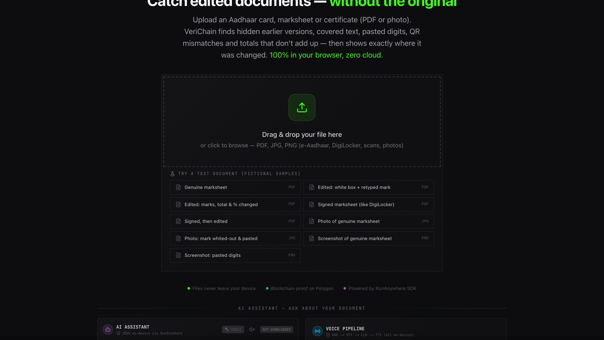
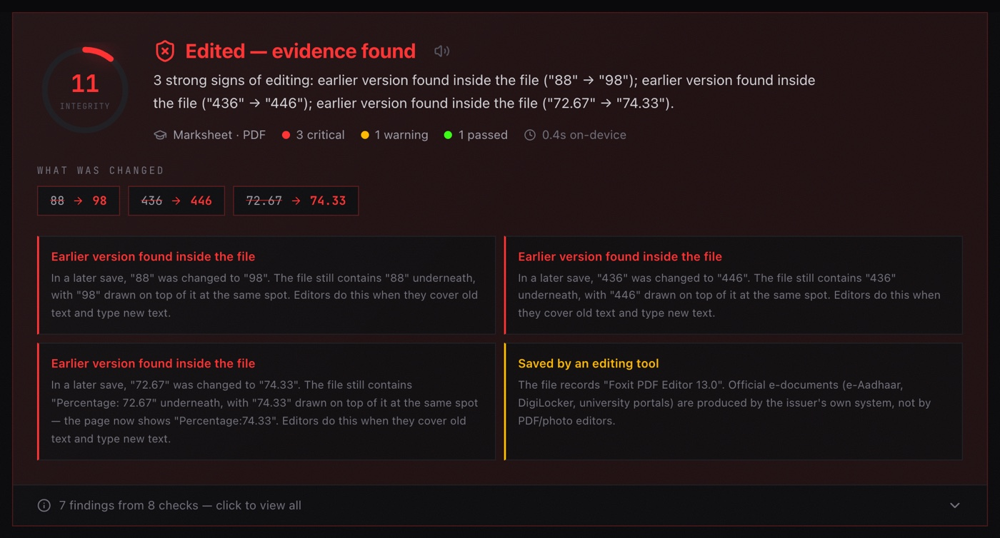
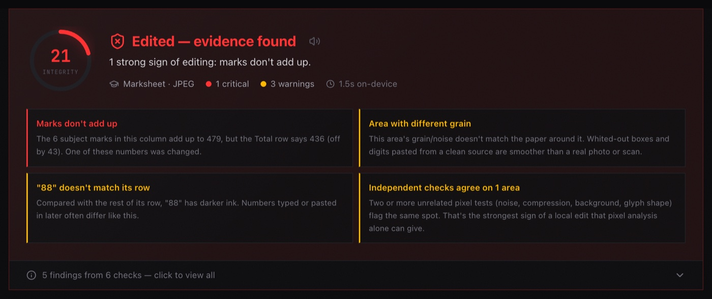
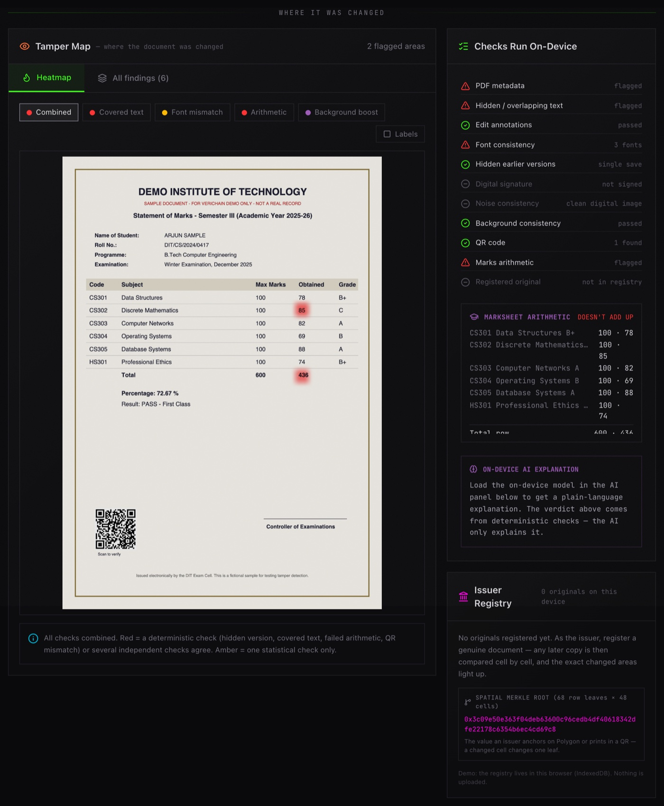
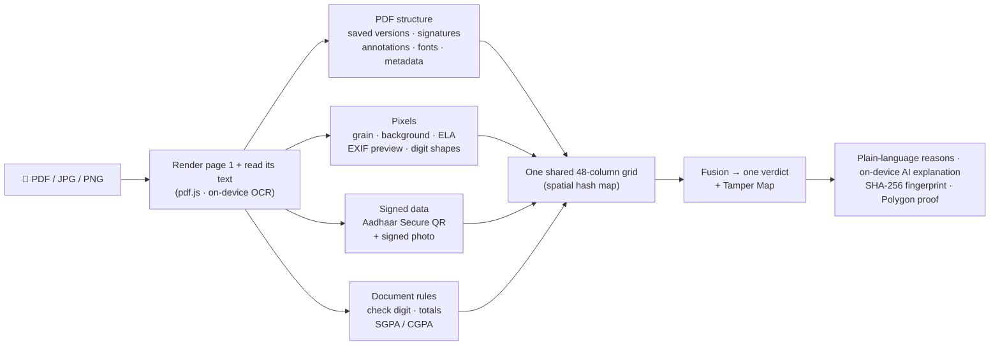

<div align="center">

# VeriChain

### Catch edited Aadhaar cards and marksheets — without the original, and without uploading them anywhere.

VeriChain finds hidden earlier versions, covered text, swapped photos, QR mismatches and numbers that don't add up —
then shows **what** was changed and **where** on the page. Every check runs **inside your browser**.

<br/>

[](https://veri-chain-orcin.vercel.app)


[What it catches](#what-it-catches) · [How it works](#how-it-works) · [Results](#tested-on) · [Run it locally](#run-it-locally) · [Demo script](docs/DEMO.md) · [2-page overview (PDF)](docs/VeriChain-Solution-Overview.pdf)

<br/>



</div>

---

## 💡 The problem

Edited Aadhaar cards and marksheets take minutes to make with free tools like **Canva** or online PDF editors.
The person checking them — an employer, a college, a landlord — almost never has the original to compare with.
And uploading someone's ID card to a cloud AI service is a privacy risk.

**VeriChain's idea:** instead of comparing with the original, compare the document with four things a forger finds very
hard to fake — and do it all on the user's own device.

| # | Reference | In plain words | Example catch |
|---|---|---|---|
| 1 | **The document against itself** | A real page is made in one go — same ink, grain and font everywhere | A pasted "88" with darker ink than its row |
| 2 | **Older versions hidden in the file** | Editors leave the old text under the new text, or keep the old version inside the PDF | The old "45" still sits under the new "85" |
| 3 | **Signed data printed on it** | The Aadhaar Secure QR holds the real name, DOB, gender, address **and photo**, signed by UIDAI | QR says one date of birth, the card prints another |
| 4 | **The document's own rules** | Check digits, totals, percentages, SGPA / CGPA arithmetic | A CGPA that doesn't equal credit points ÷ credits |

---

<a id="what-it-catches"></a>

## 🎯 What it catches

| Forgery | How VeriChain catches it | What the verdict says |
|---|---|---|
| Date of birth changed in **Canva** (whole PDF re-made) | Printed details vs the UIDAI-signed QR | `Date of birth: 01-01-1990 (QR) → 01-01-1991 (printed)` |
| A digit typed over in an **online PDF editor** | Text, white boxes or annotations drawn over the old value — read *as it looks on the page* | `01/01/1990 → 01/01/1991`, boxed on the page |
| **Photo swapped** on an Aadhaar card | Printed photo vs the photo signed inside the QR | `Photo doesn't match the signed QR photo` |
| Name, gender, number or PIN code changed | Signed QR, Verhoeff check digit, all printed copies of the number must agree | `Name: … (QR) → … (printed)` |
| DOB and gender **erased** from a phone photo | Every Aadhaar must print them — the empty spot is highlighted | `Date of birth and gender missing from the card` |
| One mark raised, total forgotten | Column sums vs the Total row, obtained ≤ maximum, percentage | `Total 436 ≠ 476` |
| Mark, total **and** percentage all changed consistently | The earlier version is recovered from inside the PDF | `88 → 98 · 436 → 446 · 72.67 → 74.33` |
| CGPA or a grade raised on a grade card | SGPA = CP ÷ C, CGPA = cumulative CP ÷ cumulative C, Σ credits × grade points = CP | `CGPA doesn't match its credit points` |
| A signed PDF changed after signing | The signed byte range no longer covers the file | `Changed after it was signed` |

> All values above are made up. The test documents in `public/samples/` are fictional.

<table>
<tr>
<td width="50%" valign="top">

**Hidden earlier version recovered** — the forger fixed the total and the percentage too, but the PDF still remembers the old values.



**Photo of a marksheet** — the marks no longer add up, and the pasted digits have a different grain and darker ink.



</td>
<td width="50%" valign="top">

**The Tamper Map** — every check paints one shared grid over the page, so the exact changed cells light up. On the right: every check that ran, on-device.



</td>
</tr>
</table>

---

<a id="how-it-works"></a>

## ⚙️ How it works



### 1 · Read the page the way a person sees it
- **PDFs** are rendered with pdf.js, and every piece of text is taken with its exact position and font.
- **Photos** are read with on-device OCR (Tesseract). The small identity block next to a photo gets a second, zoomed-in read.
- **A "visible text" model:** when text, a white box or an annotation covers characters, the covered characters are
  replaced with what is actually drawn there. So `2005` with a `6` typed over the `5` is read as `2006` — the value a
  person sees.
- **Reading order:** text is rebuilt into lines from its position on the page, not from the file's internal order (Canva
  stores a label and its value far apart).

### 2 · Run the checks

<details>
<summary><b>PDF structure</b> — the file's own history</summary>

- **Saved versions:** every `%%EOF` marks a save. The file is cut back to an earlier save, both versions are rendered,
  and the pixels and the text are compared → *"Earlier version found inside the file"*.
- **Digital signatures:** the signed `/ByteRange` must cover the whole file. Data appended after signing is diffed
  against the signed version; a file rewritten after signing (for example to remove a password) is reported as a re-save.
- **Covered text:** text drawn over different text, text hidden under a white box, digits blanked out of a number.
- **Annotations used as edits:** FreeText, Stamp, Square and Redact annotations sitting on existing characters.
- **Fonts and metadata:** the same font embedded twice, one number in a font of its own, editors and design tools
  (Canva, iLovePDF, Photoshop…) recorded as the producer.

</details>

<details>
<summary><b>Aadhaar</b> — the signed QR, the photo and the card's own rules</summary>

The Aadhaar Secure QR is not encrypted — it is **compressed and signed**, and its format is public:

1. ZXing (WebAssembly) reads the QR → a decimal number a few thousand digits long.
2. Number → bytes → gzip → fields separated by byte `255`: version, reference ID (its first 4 digits are the last 4 of the
   Aadhaar number), name, DOB, gender, address, PIN code…
3. Next comes the holder's **photo** as JPEG 2000, decoded in the browser with the OpenJPEG decoder that ships with pdf.js.
4. The last 256 bytes are UIDAI's RSA signature.

Then VeriChain checks:

| Check | How |
|---|---|
| QR vs printed | Name (the card's name line *and* the letter's "To" name, word by word), DOB, gender, last 4 digits, PIN code |
| Photo vs QR photo | The signed photo is slid over the printed photo at many sizes, scored by normalised cross-correlation of pixels and edges. Same picture ≈ 0.93–0.97, a different person ≈ 0.40–0.60 |
| Check digit | Verhoeff — changing any single digit, or swapping two neighbours, always breaks it |
| Required fields | Every card prints DOB (or year of birth) and gender; if they are missing, the spot where they belong is boxed |
| Copies must agree | The number and the VID are printed several times; all copies must match |

From images, OCR mistakes are expected, so a doubtful value is **read again, enlarged**, before it counts. An image too
small to read reliably is reported as *"Couldn't verify — image too small"* rather than accused.

</details>

<details>
<summary><b>Marksheets and grade cards</b> — the arithmetic</summary>

- **Marks:** the table is rebuilt from positioned text; each column must add up to the Total row, obtained ≤ maximum,
  and the percentage must equal obtained ÷ maximum × 100.
- **Grade cards:** SGPA = credit points ÷ credits, CGPA = cumulative credit points ÷ cumulative credits, and
  Σ (credits × grade points) + incentive points = credit points, on the standard 10-point scales (AA…FF, O / A+ … F).
  A forger who raises one grade or the CGPA rarely recomputes every number.

</details>

<details>
<summary><b>Pixels</b> — photos and screenshots</summary>

- **Noise map:** grain in each small area compared with its neighbours (whited-out patches are smoother).
- **Background micro-steps:** a slightly different white where a box was pasted.
- **ELA (JPEG only):** areas that react differently to re-compression.
- **EXIF:** editing software, dates, and the preview image stored inside the JPEG compared with the image itself.
- **Digit consistency:** every number compared with its own row — ink, colour, sharpness, size, baseline.

</details>

### 3 · Fuse everything into one honest verdict

Some checks are **proof** (the QR disagrees, the maths is wrong, an older version exists). Others are only **hints**
(the grain looks different). Proof alone can say "Edited". Hints alone can only say "Suspicious" — unless two independent
hints agree on the same spot. On ID cards (photos, emblems, colour bands), a single pixel hint is information only.

| Verdict | When |
|---|---|
| 🟥 **Edited — evidence found** | At least one deterministic finding |
| 🟨 **Suspicious** | Only warnings |
| 🟩 **No signs of editing found** | Checks ran and found nothing — **never called "genuine"**: only the issuer's original can prove that |
| 🟩 **Matches the registered original** | Same content as an original registered by the issuer |
| ⬜ **Couldn't verify** | Too little could be checked (unreadable QR, image too small) |

### 4 · With the original: the issuer registry
An issuer can register a genuine file once. Any later copy is compared **cell by cell** on the same grid, and a
**spatial Merkle root** — one hash per grid row — is the single value an issuer would anchor on Polygon or print as a QR.

### 5 · Explain, fingerprint and prove
- **On-device AI** (RunAnywhere SDK: LFM2-350M, Whisper, Piper, Silero VAD) explains the verdict in plain words and answers
  questions by text or voice. **It explains — it never decides.** The verdict comes from the deterministic checks.
- **SHA-256 + perceptual hash** fingerprints, and a proof on the **Polygon Amoy** testnet when MetaMask is connected
  (otherwise a clearly labelled local proof).

---

<a id="tested-on"></a>

## 🧪 Tested on

Real e-Aadhaar PDFs, Aadhaar photos and university grade cards — originals and versions edited with **Canva**, an
**online PDF editor** and photo editing — plus forgeries generated from the genuine files, and the nine fictional samples.

| Group | Cases | Result |
|---|---|---|
| PDFs — edited (DOB, name, gender, number, PIN, photo swapped or pasted over, DOB erased, grade, SGPA, CGPA) | 15 | ✅ all flagged **Edited**, with the exact change and its place |
| PDFs — genuine (incl. password-removed and re-saved copies) | 4 | ✅ all **No signs of editing** |
| Images — edited (DOB changed or erased, photo swapped, name changed, grade / CGPA changed) | 10 | ✅ all flagged **Edited** |
| Images — genuine (screenshots, WhatsApp-compressed, high-resolution, phone photos) | 7 | ✅ all **No signs of editing** |
| Images — too small to read (≈550 px wide) | 2 | ✅ **Couldn't verify — image too small** (no false accusation) |
| Built-in fictional samples | 9 | ✅ all as expected |
| **Total** | **47** | **47 / 47** |

Personal test documents are never part of this repository. You can run the same kind of matrix on your own files with
the dev-only lab page (see below).

---

## 🔒 Privacy by design

- **Nothing is uploaded.** PDF parsing, OCR, QR decoding, photo comparison, every check and the AI model run in the browser.
- **Self-hosted engines.** pdf.js, Tesseract, ZXing and their WebAssembly files are served from `public/vendor/`
  (copied on `npm install`), so no third-party server sees the document.
- **No accounts, no analytics.** The registry and analysis records live in the browser's IndexedDB.
- The only network calls are the optional blockchain transaction and the one-time AI model download.

---

## 🛠 Tech stack

| Layer | Tools |
|---|---|
| App | Next.js 16 (App Router, Turbopack) · React 19 · TypeScript · Tailwind CSS 4 · Framer Motion · lucide-react |
| Documents | pdf.js (`pdfjs-dist`, incl. OpenJPEG for JPEG 2000) · exifr |
| Text & QR | tesseract.js (on-device OCR) · zxing-wasm (QR) |
| On-device AI | RunAnywhere Web SDK — LFM2-350M (llama.cpp WASM), Whisper Tiny, Piper TTS, Silero VAD |
| Proof | Web Crypto (SHA-256) · perceptual hash · ethers v6 → Polygon Amoy |
| Offline | Service worker + web app manifest · COOP / COEP headers for multi-threaded WebAssembly |

---

<a id="run-it-locally"></a>

## 🚀 Run it locally

**Requirements:** Node.js 20.9+ and a Chromium-based browser (Chrome or Edge recommended).

```bash
git clone https://github.com/devenmundada/VeriChain.git
cd VeriChain
npm install        # also copies the pdf.js / Tesseract / ZXing runtimes into public/vendor
npm run dev        # http://localhost:3000
```

```bash
npm run build && npm start   # production build
npm run make-samples         # rebuild the fictional sample documents (macOS)
```

Open the home page and click any **fictional sample** to see a verdict in about a second — no upload, no sign-up.

**Regression lab (dev only):** serve a folder of test files on `127.0.0.1` with CORS enabled, then open
`http://localhost:3000/lab?base=http://127.0.0.1:8765/&files=a.pdf,b.jpg` to run the real engine on each file and see its
verdict and heatmap. The page returns 404 in production builds.

**Deploying:** Vercel works out of the box. `next.config.ts` sends the `Cross-Origin-Opener-Policy` and
`Cross-Origin-Embedder-Policy` headers that multi-threaded WebAssembly needs; keep them on any other host.

---

## 📁 Project structure

<details>
<summary>Where each part lives</summary>

```
src/
├── app/
│   ├── page.tsx                  # Main page: upload → verdict → Tamper Map → fingerprint → AI
│   ├── verify/[id]/page.tsx      # Shows an analysis record stored on this device
│   ├── api/verify/[id]/route.ts  # Stub API (verification happens client-side)
│   └── lab/                      # Dev-only regression page (404 in production)
├── lib/
│   ├── forensicEngine.ts         # analyzeDocument(): runs every check, returns the verdict
│   ├── AppContext.tsx            # Pipeline state, PDF password prompt, AI narration
│   ├── hashEngine.ts             # SHA-256 + perceptual hash
│   ├── blockchain.ts             # Polygon Amoy proof
│   ├── runanywhere.ts            # On-device LLM, speech-to-text, text-to-speech, voice activity
│   └── forensics/
│       ├── pdfForensics.ts       # Saved versions, signatures, covered text, annotations, fonts, metadata
│       ├── imageForensics.ts     # Noise map, background, ELA
│       ├── exifForensics.ts      # EXIF + stored preview
│       ├── glyphForensics.ts     # Each number vs its row
│       ├── textLines.ts          # Reading-order lines from positioned text
│       ├── ocr.ts · qr.ts        # Tesseract (incl. zoomed re-reads) · ZXing
│       ├── aadhaar.ts            # Secure QR / XML QR parsing, Verhoeff
│       ├── aadhaarChecks.ts      # QR vs printed, required fields, copies, PIN
│       ├── photoMatch.ts         # Printed photo vs signed QR photo
│       ├── aadhaarPhoto.ts       # JPEG 2000 decoding + finding the printed photo
│       ├── marksheet.ts          # Totals, percentage, SGPA / CGPA
│       ├── registry.ts           # Issuer registry, spatial Merkle root
│       ├── fusion.ts             # One verdict + one heatmap
│       └── types.ts              # Evidence, layers, the shared TamperGrid
└── components/                   # VerdictCard, HeatmapViewer, checks panel, registry, AI panels…
public/samples/                   # Nine fictional sample documents
scripts/                          # Sample generator, WebAssembly asset copying
```

</details>

---

## ⚖️ Honest limits

- A **blurry or forwarded** Aadhaar image can't have its dense QR read, so a changed name can't be proven from it
  (required fields, number copies and the check digit are still checked).
- The **UIDAI signature** inside the QR is read but not yet verified against UIDAI's certificate.
- PDF signatures are checked for coverage, not for the signer's certificate.
- A document **rebuilt from scratch** with every value consistent only shows its design-tool metadata — which is exactly
  why the issuer registry exists.
- The registry is a browser-local demo store, not a shared backend.

## 🗺 Roadmap

- Verify the UIDAI QR signature with UIDAI's public certificate
- A shared issuer registry with an on-chain contract for originals and revocations
- Copy-move detection for photos
- More documents: PAN, driving licence, degree certificates
- Camera capture with on-screen guidance for sharp, QR-readable photos

---

## 🙏 Acknowledgements

[pdf.js](https://mozilla.github.io/pdf.js/) · [Tesseract.js](https://tesseract.projectnaptha.com/) ·
[zxing-wasm](https://github.com/Sec-ant/zxing-wasm) · [OpenJPEG](https://www.openjpeg.org/) ·
[RunAnywhere SDK](https://docs.runanywhere.ai/) · [ethers.js](https://docs.ethers.org/) · [Polygon](https://polygon.technology/) ·
[Next.js](https://nextjs.org/)

## 👤 Author

**Deven Mundada** — [github.com/devenmundada](https://github.com/devenmundada)

## 📄 License

MIT

<div align="center">
<br/>
<b>VeriChain</b> — find the edit, show the proof, keep the document on the device.
</div>
